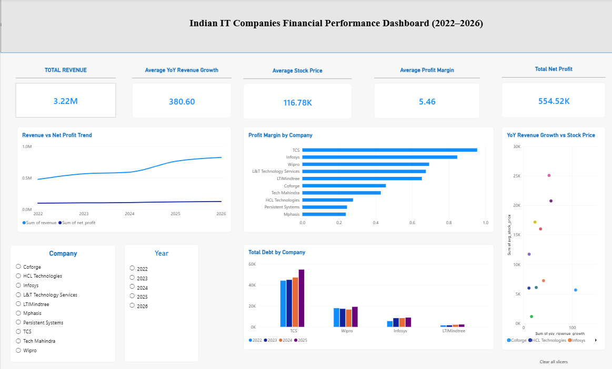

# Indian IT Companies Financial Performance Dashboard (FY2022-FY2026)

An analysis of the financial health of 10 Indian IT companies over five years (FY2022-FY2026), to see which company is financially strongest and how that connects to stock price performance.

**Companies:** TCS, Infosys, Wipro, HCL Technologies, Tech Mahindra, LTIMindtree, Persistent Systems, Coforge, Mphasis, L&T Technology Services.

## What I did

1. Collected five years of financial data (revenue, net profit, operating profit, debt, EPS) from screener.in
2. Pulled daily stock prices for all 10 companies using Python (yfinance)
3. Cleaned and merged everything into one table using Pandas
4. Loaded the data into SQL Server and wrote queries for profit growth, margin ranking, year-over-year growth and debt trends
5. Built a Power BI dashboard to visualize the results

## Tools used

- Python (Pandas, yfinance)
- SQL Server
- Power BI

## Files

| File | Description |
|---|---|
| `company_financials_data.ipynb` | Data collection and cleaning code |
| `company_financials_data.csv` | Final merged dataset |
| `company_financials.sql` | SQL analysis queries |
| `company_financials.pbix` | Power BI dashboard file |
| `company_financials.png` | Dashboard screenshot |

## Key findings

- Sector-wide revenue grew steadily from 2022 to 2026, but total net profit stayed almost flat over the same period, which suggests margins are being squeezed across the industry.
- TCS and Infosys lead the group on profit margin.
- TCS carries by far the largest debt load among the companies with available debt data, and it has grown every year.
